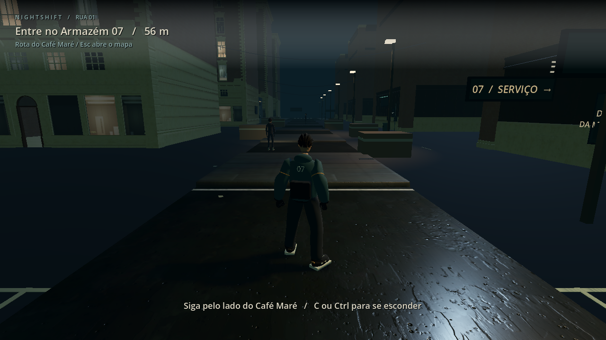
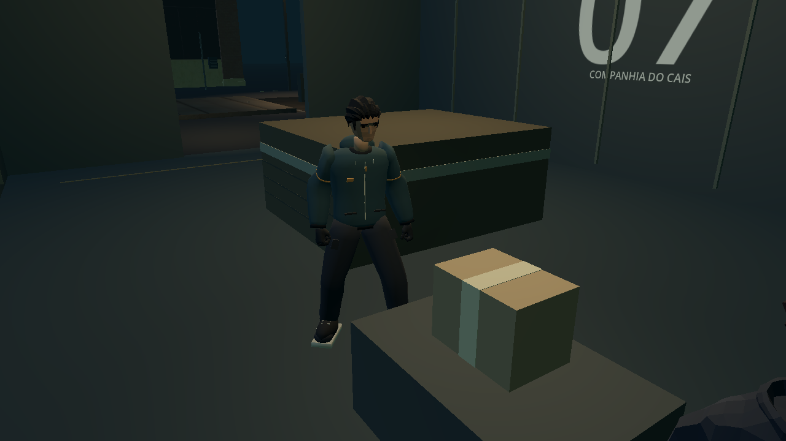
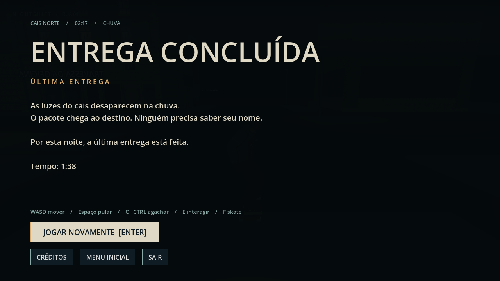

# NIGHTSHIFT — Última Entrega

**Um projeto indie 3D de infiltração urbana, com atmosfera noir e fuga de skate.**

É madrugada no Cais Norte. Um entregador precisa entrar no Armazém 07,
recuperar um pacote e desaparecer pelas ruas antes que a vigilância o alcance.
NIGHTSHIFT combina observação de patrulhas, uso de cobertura e deslocamento
em terceira pessoa em uma pequena missão integrada.

Projeto de **Lucas**, desenvolvido com assistência do Codex. Esta é uma versão
**jogável em desenvolvimento**, apresentada como trabalho de portfólio.
O número interno `1.0` identifica a build atual; não significa que o jogo esteja
finalizado ou que a qualidade de todas as animações esteja aprovada.

## Proposta

Uma última entrega em um bairro portuário: ruas molhadas, luzes de serviço,
trilha instrumental trip-hop/noir e sons de chuva e cidade distante. O percurso
leva da rua ao interior do armazém e termina em uma fuga arcade de skate.
A proposta é uma experiência curta, com uma missão e um cenário concentrado.

## O que está implementado

- Protagonista estilizado com rig nativo, Idle, Walk, Run, agachamento e salto.
- Caminhada, corrida, curvas, colisões e câmera em terceira pessoa com ajuste
  de distância e proteção contra obstáculos.
- Guardas com patrulha, campo de visão, suspeita, perseguição, busca e captura.
  Obstáculos e agachamento permitem evitar a detecção.
- Armazém acessível, porta interativa, pacote coletável e alarme na coleta.
- Skate arcade com montagem, aceleração, impulso, curvas e frenagem.
- Extração, vitória, derrota, reinício, menu inicial, créditos e pausa com mapa.
- Iluminação noir, sinalização urbana, música, ambientes e efeitos de ações.

O percurso completo foi concluído por teste automatizado, com os guardas
ativos, sem teletransportar o jogador nem forçar objetivos. A build Windows
também passou pelo percurso. Isso comprova a possibilidade técnica de terminar
a missão, sem substituir uma avaliação humana dos controles e do visual.
Consulte [validação e limites dos testes](docs/VALIDACAO.md).

## Capturas da versão atual

Imagens renderizadas no projeto principal, sem montagem ou arte conceitual.
A captura da Rua 01 e a do armazém usam enquadramentos preparados; a tela de
vitória foi registrada após o percurso automatizado da build Windows.

## Controles

Teclado e mouse:

| Ação | Controle |
| --- | --- |
| Mover a pé | W, A, S, D |
| Correr | Segurar Shift |
| Pular a pé | Espaço |
| Agachar | Segurar C ou Ctrl |
| Abrir a porta / recolher o pacote | Segurar E, parado e próximo do objeto |
| Subir / descer do skate | F, em uma posição segura |
| Acelerar no skate | W |
| Virar no skate | A / D |
| Frear no skate | S ou Espaço |
| Girar a câmera | Mouse |
| Ajustar distância / recentrar a câmera | Roda do mouse / R |
| Pausa e mapa | Esc |
| Ligar / desligar música | M |
| Alternar tela cheia | F11 |
| Começar / jogar novamente | Enter ou botão do menu |

Para a primeira tentativa, procure a rota de serviço pelo **Café Maré**.
Abra o Armazém 07, recolha o pacote e saia. Depois da coleta, perca a
perseguição e atravesse uma área de extração **sobre o skate, com velocidade**.
O mapa da pausa indica o caminho ao Cais Norte. Interações podem ficar
indisponíveis enquanto você se move, está no skate ou é perseguido.

## Como executar

1. Baixe ou clone este repositório completo.
2. Instale o **Godot 4.7.2 Standard**, versão usada na validação. Não é necessário
   o editor .NET. Outras versões não foram certificadas para este projeto.
3. No gerenciador de projetos do Godot, escolha **Importar** e selecione o
   `project.godot` desta pasta.
4. Aguarde a importação dos recursos e pressione **F5**. Inicie pelo menu.

Modelos, texturas e WAVs necessários estão incluídos. O Godot recria o cache
`.godot/` na primeira abertura. Não é necessário baixar assets, usar Blender,
instalar Python ou acessar serviços online para jogar.

### Windows portátil

Uma build Windows x64 já foi gerada e testada localmente. **Não há release
pública disponibilizada nesta preparação do repositório.** Quando uma build
for distribuída, extraia a pasta completa e execute `NIGHTSHIFT.exe`, mantendo
`NIGHTSHIFT.pck` ao lado. A distribuição é portátil, sem instalador nem
assinatura digital.

Para gerar a build pelo editor, instale os templates de exportação da mesma
versão do Godot e use o preset **Windows Desktop** em **Projeto → Exportar**.
O destino configurado é `dist/NIGHTSHIFT-1.0-Windows/NIGHTSHIFT.exe`.
Distribuições devem acompanhar os créditos e avisos de licença da raiz.

## Tecnologias e organização

| Tecnologia | Uso |
| --- | --- |
| Godot 4.7.2 / GDScript | Cena 3D, controles, missão, IA, câmera e interface |
| GL Compatibility / OpenGL | Renderização com foco em GPUs integradas |
| AnimationPlayer / AnimationTree | Transições nativas via AnimationPlayer; AnimationTree preservado no caminho legado |
| Blender | Preparação dos modelos, roupas e postura fixa do skate |
| glTF / GLB e WAV | Modelos, animações e áudio incluídos no projeto |

`main.tscn` e `main.gd` montam a fase; `scenes/` contém as cenas do jogador;
`scripts/` reúne os sistemas; `assets/` contém os recursos e suas origens;
`environments/` configura o ambiente; `docs/` reúne a apresentação e evidências.
Backups, provas antigas, ferramentas locais, cache e builds ficam fora do Git,
preservados na cópia de desenvolvimento. Veja [preparação da publicação](docs/PUBLICACAO.md).

## Estado atual e limitações

- **Skate provisório:** utiliza uma postura fixa preparada no rig nativo.
  Não há animação de remada, manobras ou simulação física realista.
- A cadência dos passos, o deslizamento dos pés e as transições de salto ainda
  precisam de avaliação visual. Os clipes de locomoção são reproduzidos em 1×.
- A missão é tecnicamente concluível, mas diversão, dificuldade, legibilidade
  e conforto da câmera precisam de partidas manuais com jogadores.
- A duração pretendida de uma primeira partida não foi comprovada. O teste
  com uma rota conhecida concluiu o percurso em aproximadamente **1min38s**.
- Amostras curtas anteriores na **Intel Iris Xe, em 1280×720**, ficaram próximas
  de 60 FPS. Isso não representa FPS mínimo nem garantia em outras máquinas.
- O projeto contém uma missão e um conjunto limitado de interiores acessíveis.
  Não é um mundo aberto nem uma versão comercial finalizada.
- O teste com encerramento automático antecipado registra um aviso de objetos
  não liberados na saída. A abertura e o percurso completo terminam com código 0;
  o aviso foi documentado e não corrigido nesta tarefa.

Nesta preparação para GitHub foram alteradas apenas documentação e configuração
do repositório. Nenhum sistema do jogo foi corrigido ou ampliado.

## Créditos e licenças

- **Lucas:** conceito, direção do projeto e desenvolvimento com assistência do Codex.
- **Quaternius:** cidade Downtown City MegaKit Standard; rig e animações da
  Universal Animation Library Standard; modelos do Ultimate Modular Men Pack.
  Recursos de terceiros sob **CC0 1.0**.
- **Kenney:** prancha Mini Skate e dados de animação do caminho legado, **CC0 1.0**.
- **Áudio:** música, chuva, cidade e efeitos sintetizados originalmente para
  NIGHTSHIFT, declarados **CC0 1.0** nos créditos existentes.
- **Godot Engine:** MIT; avisos do engine e componentes em
  [GODOT_LICENSE.txt](GODOT_LICENSE.txt) e
  [GODOT_THIRD_PARTY_NOTICES.txt](GODOT_THIRD_PARTY_NOTICES.txt).

As fontes oficiais, o alcance de cada licença e os arquivos abrangidos estão
em [LICENCAS.md](LICENCAS.md) e [CREDITS.txt](CREDITS.txt). A licença do código
e dos elementos autorais do jogo **ainda não foi definida por Lucas**;
as permissões CC0 dos assets não se estendem automaticamente ao projeto inteiro.
